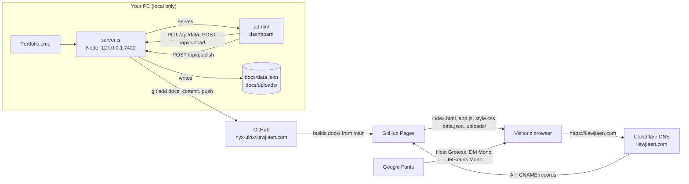
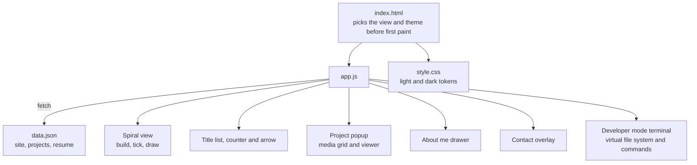
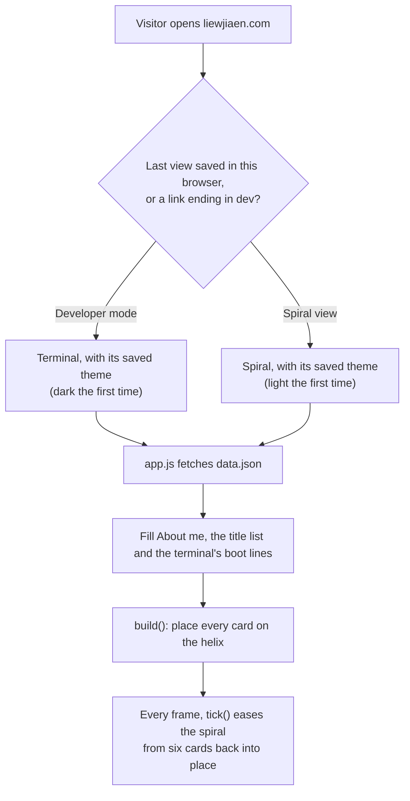
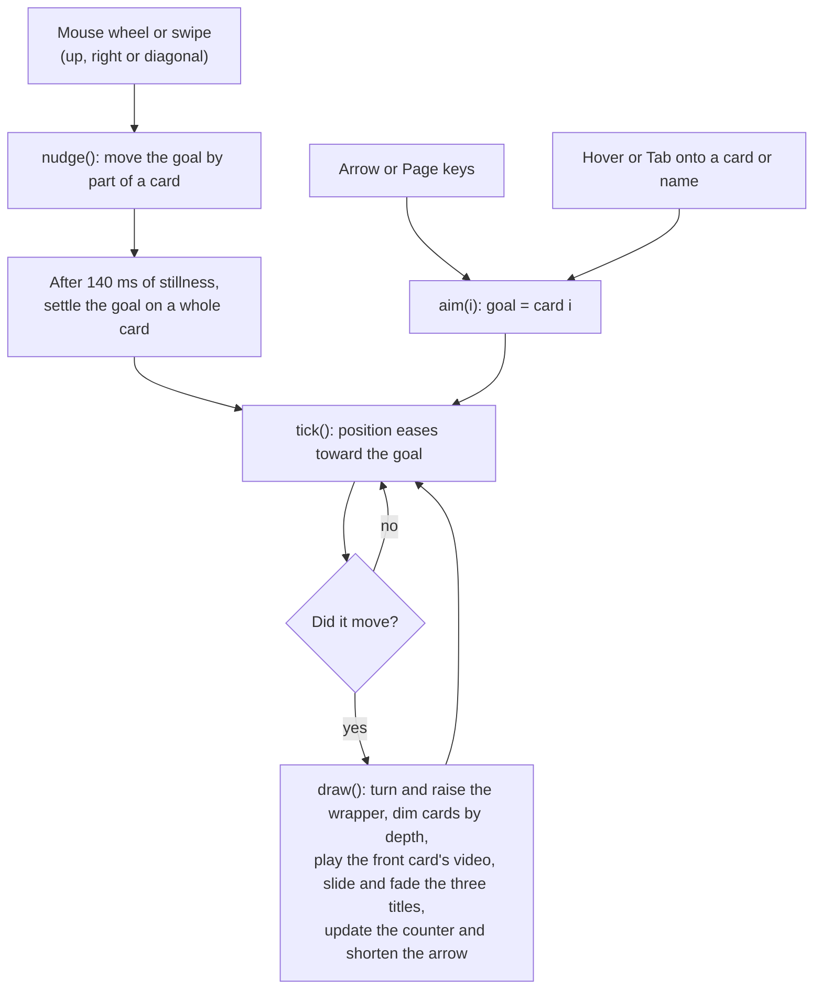
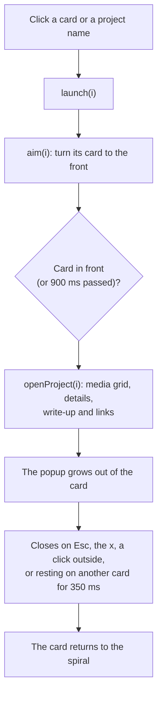
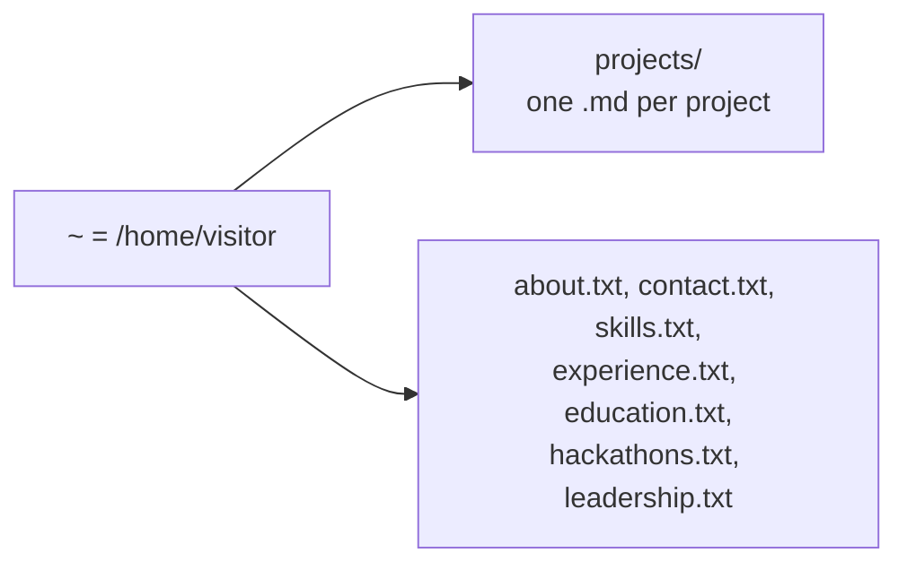
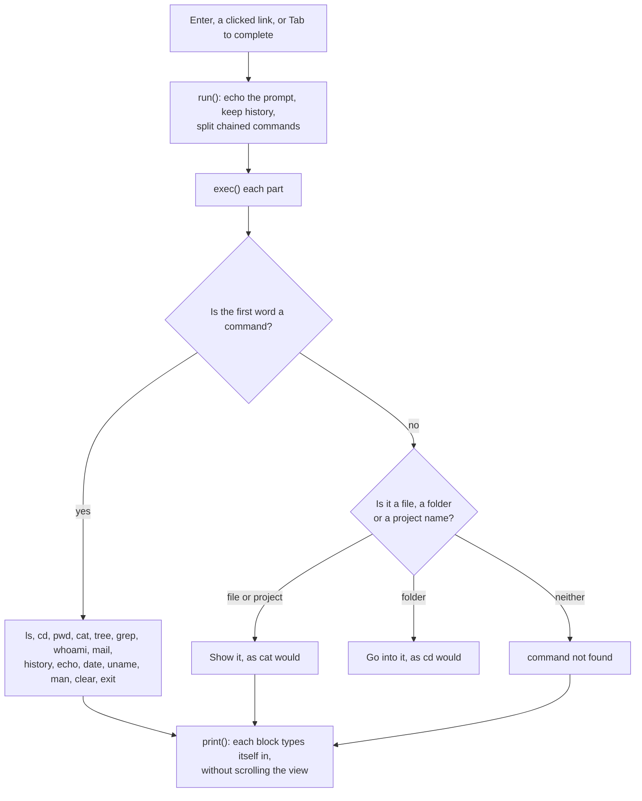
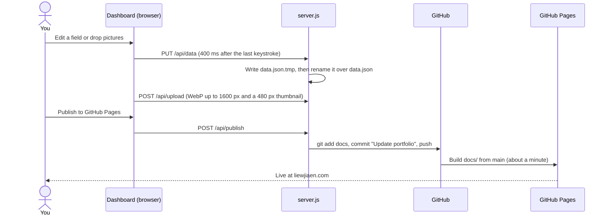

# Portfolio · liewjiaen.com

Malcolm Liew Jia En's portfolio: project cards on a 3D spiral that turns as you scroll, with the project names listed large in the corner, plus a Developer mode that works like a Linux terminal. It is a static site (HTML, CSS and one JavaScript module, no build step) hosted free on GitHub Pages, and a small dashboard on your PC edits it.

- **Live site:** https://liewjiaen.com
- **Add or edit entries:** double-click `Portfolio.cmd`, or read [ADDING-ENTRIES.md](ADDING-ENTRIES.md)
- **Code map:** [graphify-out/GRAPH_REPORT.md](graphify-out/GRAPH_REPORT.md) (a knowledge graph of the code; open `graphify-out/graph.html` in a browser to explore it)

## Platforms this project needs

| Platform | What it does here | Where to find it |
|---|---|---|
| **GitHub** | Holds the code and all content. The dashboard's Publish button pushes here. | https://github.com/nyx-ulrix/liewjiaen.com (account `nyx-ulrix`) |
| **GitHub Pages** | Hosts the site for free. It serves the `docs/` folder of the `main` branch at the custom domain `liewjiaen.com`, with HTTPS enforced, and rebuilds about a minute after each push. | Repository → Settings → Pages |
| **Cloudflare** | The domain `liewjiaen.com` and its DNS: four `A` records pointing at GitHub Pages (`185.199.108.153`, `185.199.109.153`, `185.199.110.153`, `185.199.111.153`) and a `www` `CNAME` to `nyx-ulrix.github.io`, all set to "DNS only" (grey cloud) so GitHub can issue the HTTPS certificate. | https://dash.cloudflare.com → liewjiaen.com → DNS |
| **Google Fonts** | Serves the typefaces: Host Grotesk (all Spiral view text), DM Mono (years) and JetBrains Mono (the terminal, where SF Mono isn't installed). No account needed. | fonts.googleapis.com |
| **Your PC** | Node.js runs the dashboard (`server.js`, no npm packages). Git publishes. Any modern browser runs the dashboard, which also resizes your pictures before upload. | https://nodejs.org (LTS), https://git-scm.com |
| *Optional* | GitHub CLI (`gh`) to watch Pages builds; Python with Pillow (and `opencv-python` for videos) for the portfolio-update skill's media script; Claude Code with the `portfolio-update` and `graphify` skills. | https://cli.github.com, `~/.claude/skills/` |

Nothing else is involved: no backend, database, build step, analytics or paid service. Contact me is a `mailto:` link, so visitors write from their own mail app and the message lands in your Gmail.

## Architecture



Inside the site, `docs/index.html` loads one stylesheet and one module, and everything is drawn from `docs/data.json`:



## How the code works

### Loading the page



### Turning the spiral

Cards sit on a helix: card *i* is turned `i × 40°` around the vertical axis, pushed out to the radius and dropped a little, so nine cards make a turn and turns never overlap. Each frame only the wrapper moves (`preserve-3d` inside a `perspective` stage).



### Opening a project



### Developer mode commands

The terminal has a small Linux-style file system and a handful of familiar commands.





### Editing and publishing



The server only answers on `127.0.0.1`, rejects other host names, and requires an `X-GM` header on every API call, so other websites can't reach it.

## Repository layout

```
docs/                 the live site (GitHub Pages serves this folder)
  index.html          page shell; picks the view and theme before first paint
  app.js              everything that moves: spiral, titles, popups, contact, terminal
  style.css           light and dark themes, layout
  data.json           all content: site, projects, resume
  uploads/            pictures and videos, each with a -t.webp thumbnail
  favicon.svg, CNAME
admin/                the dashboard (local only, never published)
server.js             local server for the dashboard: saves, uploads, publishes
Portfolio.cmd         double-click to start the dashboard
ADDING-ENTRIES.md     how to add and publish entries
components/sphere/    the old sphere view, kept for reference and not published
graphify-out/         knowledge graph of the code (GRAPH_REPORT.md, graph.html, graph.json)
```
